# OVER U: экраны работающего Frappe Learning

Это снимки настоящей development-школы, а не макеты. Сохранены штатные интерфейсы релиза 2.64.0. Полный сценарий прошёл 8 октября 2026 года; первые экраны фиксируют промежуточный прогресс.

## 1. Интерфейс ученика: каталог OVER U

`http://over-u.localhost:8000/lms/courses`

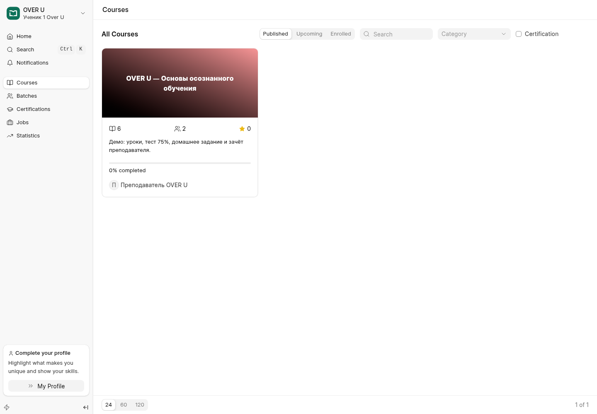

## 2. Прохождение текстового урока и последовательность

`http://over-u.localhost:8000/lms/courses/over-u/learn/1-1`

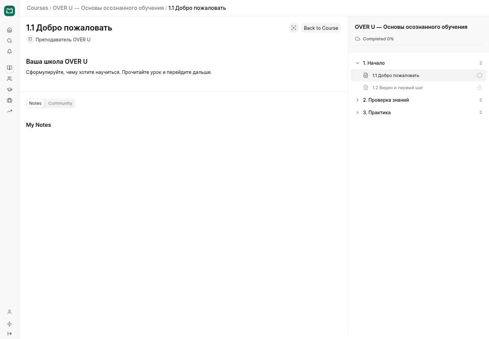

## 3. Штатный видеоплеер с локальным demo-видео

`http://over-u.localhost:8000/lms/courses/over-u/learn/1-2`

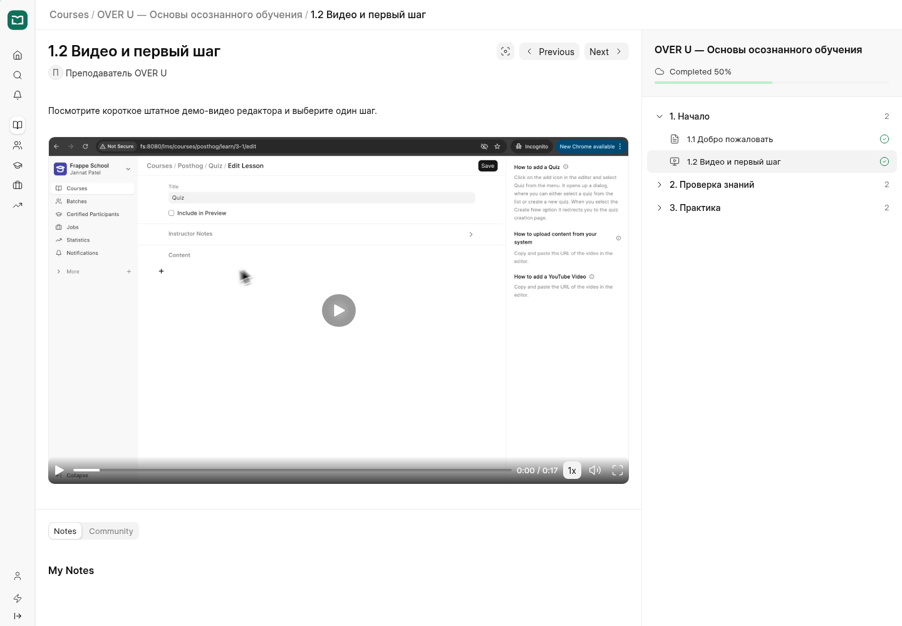

## 4. Тест: 4 вопроса, проходной балл 75%

`http://over-u.localhost:8000/lms/courses/over-u/learn/2-2`

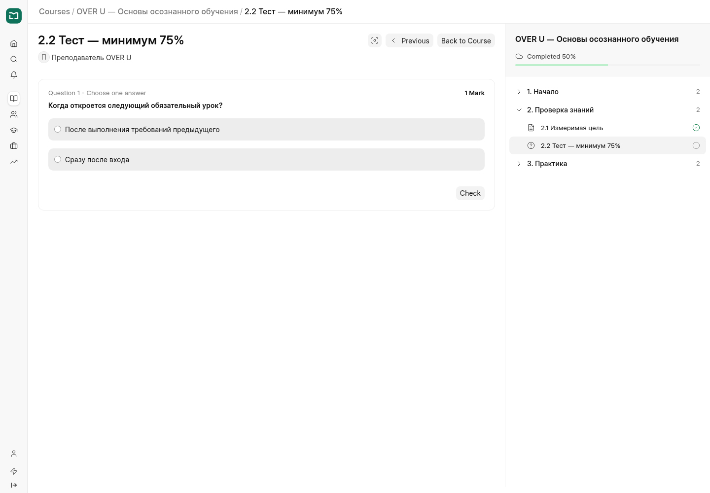

## 5. Тест отправлен через интерфейс: 3 из 4, 75%

`http://over-u.localhost:8000/lms/courses/over-u/learn/2-2`

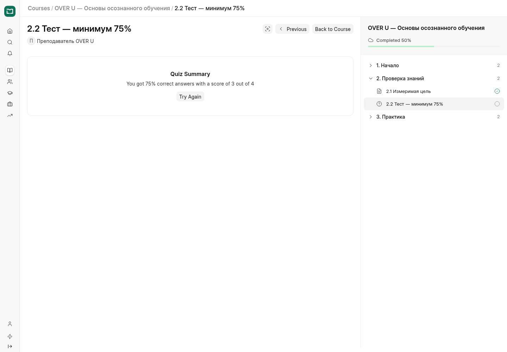

## 6. Ученик пишет и отправляет домашнюю работу

`http://over-u.localhost:8000/lms/courses/over-u/learn/3-1`

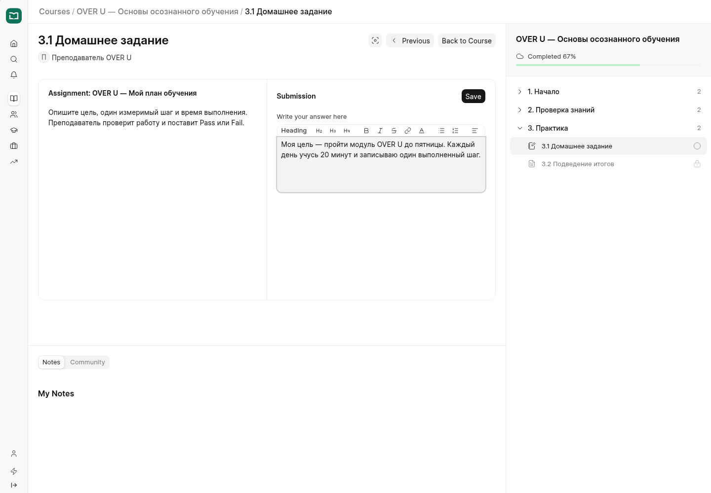

## 7. Работа отправлена: Not Graded, ожидает преподавателя

`http://over-u.localhost:8000/lms/assignment-submission/ASG-00005/ASG-SUB-00015`

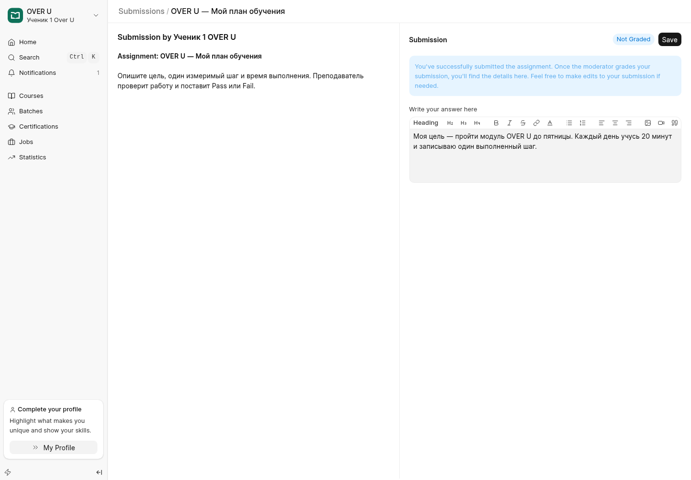

## 8. Интерфейс преподавателя и прогресс учеников

`http://over-u.localhost:8000/lms/courses/over-u#dashboard`

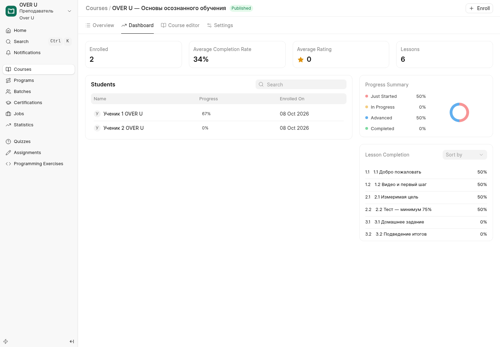

## 9. Штатный редактор курса, модулей и урока

`http://over-u.localhost:8000/lms/courses/over-u?editLesson=1-1#editor`

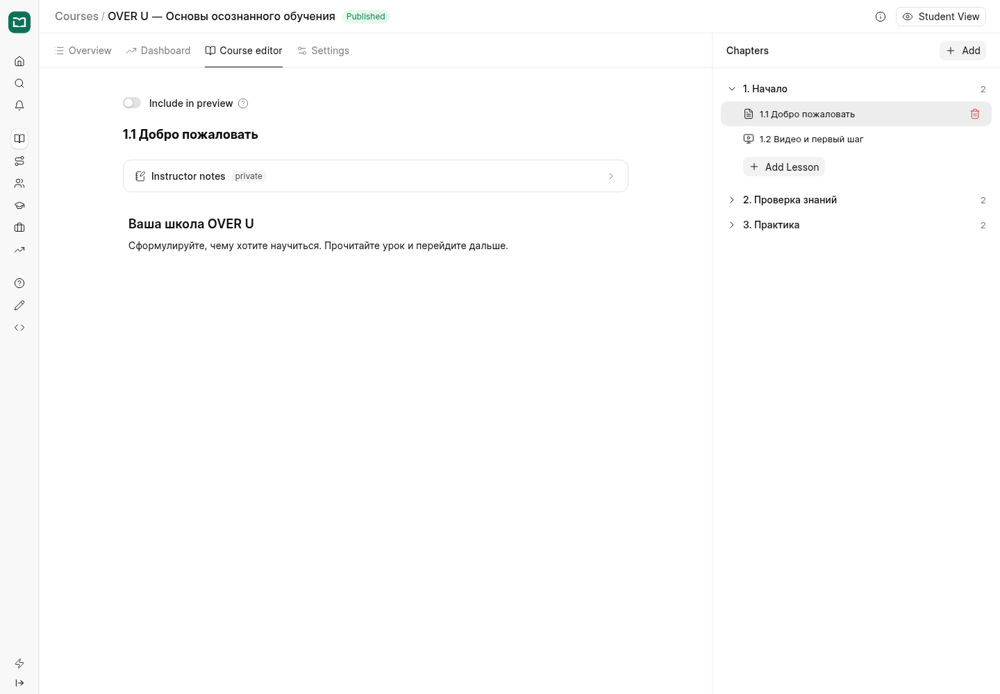

## 10. Преподаватель: список присланных работ

`http://over-u.localhost:8000/lms/assignment-submissions`

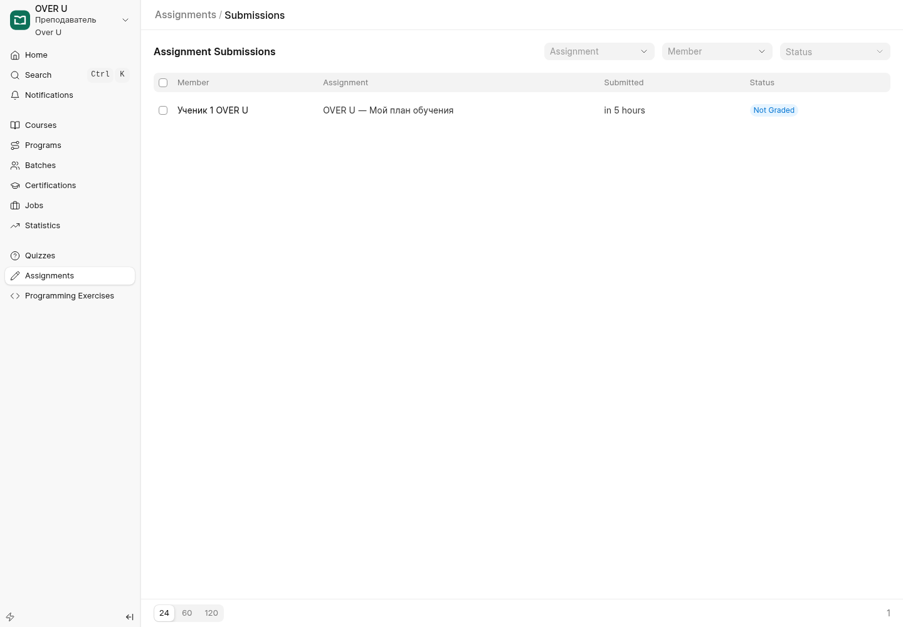

## 11. Преподаватель проверяет ответ и выбирает Pass

`http://over-u.localhost:8000/lms/assignment-submission/ASG-00005/ASG-SUB-00015`

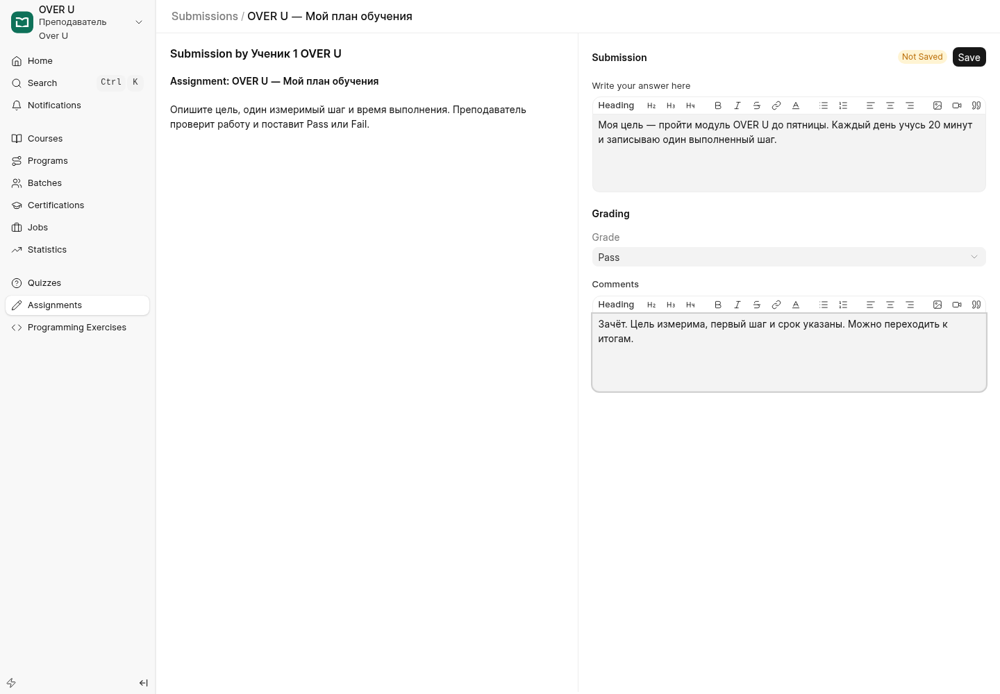

## 12. Сохранённая проверка: Pass и комментарий

`http://over-u.localhost:8000/lms/assignment-submission/ASG-00005/ASG-SUB-00015`

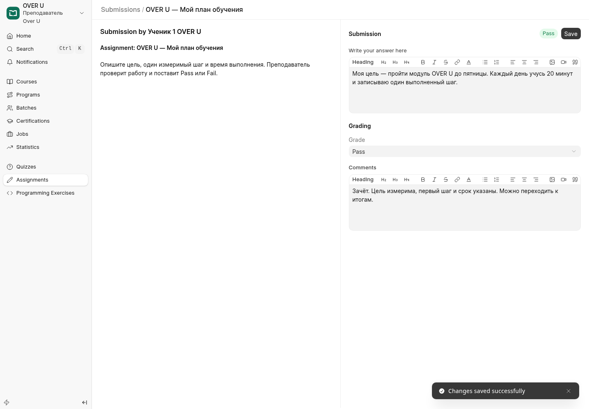

## 13. Следующий урок открыт после Pass

`http://over-u.localhost:8000/lms/courses/over-u/learn/3-2`

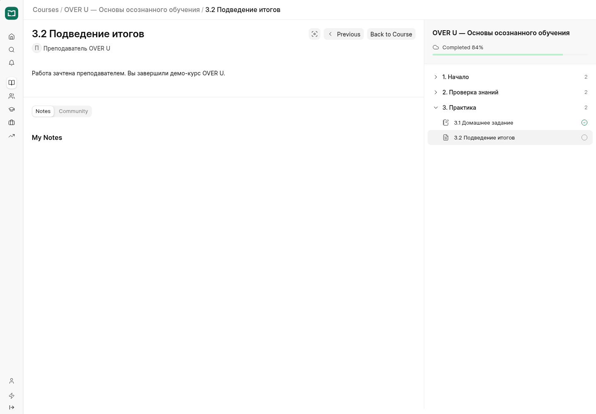

## 14. Прогресс ученика 1: 100%

`http://over-u.localhost:8000/lms/courses`

## 15. Администратор в штатном LMS

`http://over-u.localhost:8000/lms/courses`

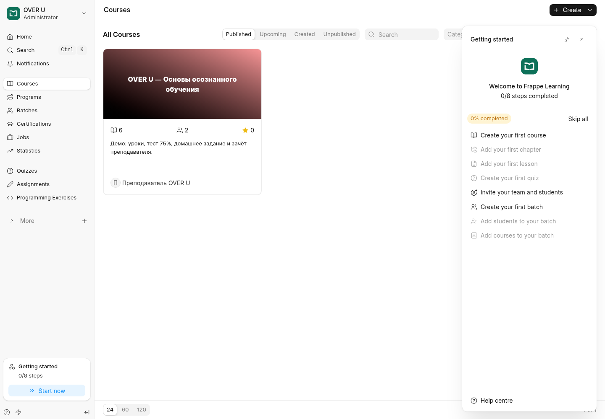
