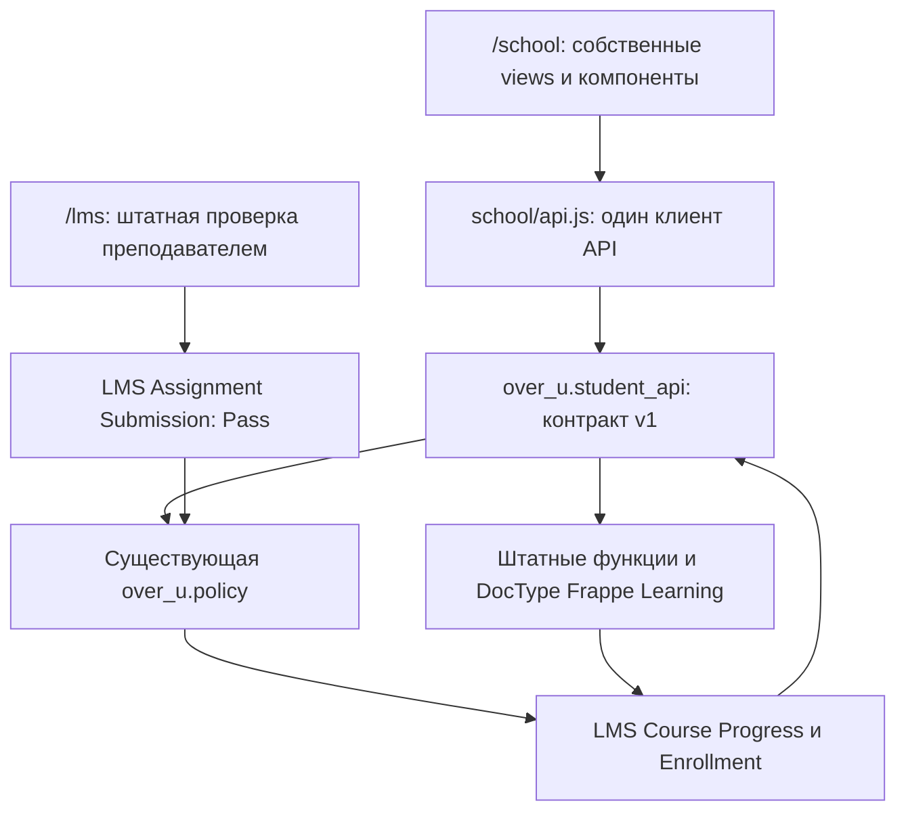

# OVER U student UI v1 — результат этапа 2

Проверено 8 октября 2026 года. Отдельная ветка `over-u/student-ui-v1` создана от `over-u/development`, исходный HEAD `c5e1acfa969904541b66021b7b55e37532d1c66b`. Этот отчёт дополняет материалы этапа POC: их исторические сведения о недоступном GitHub и незавершённом student UI больше не описывают текущее состояние.

Работает один полноценный ученический сценарий на существующем курсе `over-u`: главная, программа, текст/видео, тест, домашняя работа, ожидание проверки, закрытый урок и открытие после Teacher Pass. «Задания», «Результаты» и «Профиль» показывают минимальные реальные данные текущего пользователя. Parent UI, новый teacher UI и production deployment не создавались.

## Доступ

URL: `http://over-u.localhost:8000/school`. Адрес доступен **внутри development Cloud Environment**. Это loopback, а не публичный preview: чтобы открыть на Mac, необходим существующий туннель/port forwarding либо локальное development-окружение. Публичное размещение не выполнялось.

| Назначение | Логин | Маршрут |
|---|---|---|
| Ученик E2E | `student2@over-u.example.com` | `/school` |
| Ученик исходного POC | `student1@over-u.example.com` | `/school` |
| Преподаватель | `teacher@over-u.example.com` | `/lms` |
| Администратор | `Administrator` | `/desk` |

Demo-пароль берётся из `OVER_U_DEMO_PASSWORD`, admin — из `OVER_U_ADMIN_PASSWORD` в приватном `/workspace/over-u-runtime/dev.env`, вне репозитория. Пароли, cookies и runtime backup в код, тестовые логи и скриншоты не добавлены. Исходный приватный backup не использовался и не изменялся.

После браузерной проверки **ученик 2 имеет 100%**, собственные попытки теста 50% и 75% и зачтённую работу. Ученик 1 сохранил свои прежние 100% и данные. Состояния до завершения сохранены на скриншотах; данные пользователей не сбрасывались ради повторного теста.

## Архитектура



UI — обычные ES modules, семантический HTML и CSS, без импорта Vue-компонентов LMS, копирования LMS controllers или дополнительного frontend runtime. Браузер не обращается к generic DocType API для учебных действий. Все имена серверных endpoints находятся в одном `api.js`; серверные зависимости собраны в `student_api.py`. Маршрутизация `/school/courses/<course>/lessons/<chapter>-<lesson>` изолирована Frappe website rule. `/lms` и `/desk` используют свои исходные интерфейсы.

Контракт v1 возвращает только необходимые поля: текущий пользователь, его enrollment, outline/locks/progress, безопасный контент открытого урока, вопросы без ключей правильности, собственный результат и собственная работа/комментарий. Это контракт нашего приложения; upstream не гарантирует стабильность внутренних функций, на которые он опирается.

## Карта файлов и зависимостей API

Все пути ниже относительно корня репозитория. Префикс `APP` означает `over-u/apps/over_u/over_u/`.

| Файл | Ответственность | Изменение этапа 2 |
|---|---|---|
| `APP/student_api.py` | Session-scoped backend adapter, DTO, server actions | Создан |
| `APP/test_student_api.py` | 8 контрактных и permission/progression тестов | Создан |
| `APP/patches.txt` | Маркер структуры app для Frappe asset build; миграций нет | Создан |
| `APP/hooks.py` | Catch-all website rule только для `/school/*` | Добавлены две строки |
| `APP/www/__init__.py` | Пакет website routes | Создан |
| `APP/www/school.py` | Session/login gate, CSRF boot, отключённый page cache | Создан |
| `APP/www/school.html` | Русский document shell, viewport, skip link, module assets | Создан |
| `APP/public/school/api.js` | Единый HTTP клиент, CSRF, безопасные ошибки | Создан |
| `APP/public/school/app.js` | History router, действия, drafts, обновление статуса проверки | Создан |
| `APP/public/school/views.js` | Главная/курс/урок/quiz/homework/locked/минимальные разделы | Создан |
| `APP/public/school/components.js` | Outline, lesson rows, progress, SVG icons, escaping | Создан |
| `APP/public/school/school.css` | Типографика, цвета, responsive, keyboard focus, reduced motion | Создан |
| `over-u/dev/init.sh` | Связывает assets `over_u` при старте существующего POC volume | Добавлены две строки |
| `over-u/dev/student-ui-e2e.mjs` | Браузерный сценарий ученика и штатного преподавателя | Создан |
| `over-u/docs/STUDENT-UI-V1.md` | Этот отчёт и инструкция проверки | Создан |
| `over-u/evidence/student-ui-v1/` | Скриншоты, manifest проверок и очищенные test logs | Создан |

| Endpoint `over_u.student_api.*` | Внутренние функции, от которых он зависит | Модели |
|---|---|---|
| `home`, `course` | `lms.lms.utils.get_membership`, `can_view_course`, `get_course_outline`, `get_editorjs_blocks` | `User`, `LMS Course`, `LMS Enrollment`, `Course Chapter`, `Chapter Reference`, `Course Lesson`, `Lesson Reference`, `LMS Course Progress`; собственные submissions |
| `lesson` | Предыдущие + `utils.get_lesson`, `get_quiz_with_questions`, `get_assignment`; `lms.lms.html_sanitizer.sanitize_rich_text` | Предыдущие + `LMS Quiz`, `LMS Question`, `LMS Assignment`, `LMS Quiz Submission`, `LMS Assignment Submission` |
| `complete_lesson` | Проверка открытого урока + существующий `over_u.policy.save_progress` → штатный lesson save_progress | `LMS Course Progress`, `LMS Enrollment` |
| `submit_quiz` | Проверка размещения/доступа/формата/попыток + `lms.lms.doctype.lms_quiz.lms_quiz.submit_quiz`, затем прежний progress policy | `LMS Quiz Submission` и его child answers, progress |
| `submit_assignment` | `utils.get_assignment`, own submission lookup, обычный `Document.insert/save` с DocPerm и существующими hooks | `LMS Assignment Submission`, progress при последующем Pass |

Все write endpoints разрешают только POST. Browser member/status/evaluator/submission ID не принимаются; quiz и assignment выбирает сервер из доступного урока. Enrollment проверяется явно по текущей сессии. У студента нет generic `LMS Course` DocPerm чтения для authoring Desk: адаптер применяет **штатный portal access rule** `can_view_course` вместе с собственным enrollment, не меняя ролей или DocPerm. Запись submissions сохраняет обычные проверки Frappe, без `ignore_permissions`.

Ответы задания — plain text, экранируются до HTML. Авторский rich text проходит штатный sanitizer; instructor-only content не выдаётся. Проверенный payload не содержит поля правильности или explanations. Чужие submissions не входят в DTO, даже когда существуют у другого участника этого же курса. Это защита нового адаптера, а не обещание полного аудита всех старых upstream endpoints.

## Механика прохождения

Обычный урок завершает существующий progress API. Quiz оценивается штатным backend, клиент не передаёт балл или Pass. При 50% урок остаётся незавершённым; при 75% становится выполненным. Retry соблюдает исходный `max_attempts`.

Текстовая работа создаёт/изменяет только собственную submission. `Not Graded` не завершает урок и не открывает следующий. Штатный преподаватель ставит `Pass` через `/lms`; **прежние hooks OVER U** пересчитывают completion и enrollment. Новый UI только читает обновлённый результат. Проверка статуса — раз в 15 секунд на видимой странице ожидающей работы; также есть ручная кнопка. Редактируемый draft не заменяется polling. Зачтённый ответ остаётся неизменяемым согласно прежнему policy.

Визуальное направление: светлый тёплый фон, белые учебные панели, тёмно-зелёное основное действие, спокойные amber/green состояния, крупная serif типографика заголовков и простой system sans для чтения. Текстовая надпись OVER U, без нового логотипа и сторонних декоративных assets. Смысл статусов передаётся текстом и иконками, не только цветом.

## Проверки

**58 backend проверок прошли:** 8 новых student API + 9 прежних OVER U policy; 31 upstream integration + 7 unit для lesson locking; 3 upstream запрета самостоятельной оценки. Это целевой regression набор, не весь Frappe Learning suite.

`over-u-tests.log` и `upstream-tests.log` в evidence содержат результаты текущего этапа. `validation.json` имеет `status: passed`, нет uncaught browser JS errors. Browser E2E проверил настоящий вход через форму, три обычных урока включая воспроизводимое видео, quiz 50% → retry 75%, домашнюю работу, закрытый прямой URL финального урока, штатный teacher Pass, автоматическое обновление статуса и 100% прогресса. При сетевой ошибке отправки draft сохраняется; переход в профиль и browser Back также сохраняют его. Проверены own-data isolation, минимальные разделы, keyboard navigation и перенос фокуса.

Проверены ширины 320, 390, 768 px без горизонтального переполнения и layout viewport 720 CSS px, эквивалентный desktop 1440 при 200% zoom. Последнее — проверка компоновки, не отдельная сертификация всех браузерных zoom/accessibility сценариев. Использован Chromium с reduced-motion. Все восемь запрошенных экранов просмотрены визуально.

`/lms` преподавателя и редактор реально открылись и использовались для проверки. **`/desk` открывает исходный setup wizard:** он отображается без JS ошибок, но initial setup административного workspace в POC ещё не завершён. Wizard не обходился, настройки школы ради screenshot не менялись. Полный admin workflow этим smoke check не проверен.

## Скриншоты

Пути относительно этого документа:

| Запрошенный экран | Файл |
|---|---|
| Главная | [01-home.png](../evidence/student-ui-v1/01-home.png) |
| Курс | [02-course.png](../evidence/student-ui-v1/02-course.png) |
| Урок | [03-text-lesson.png](../evidence/student-ui-v1/03-text-lesson.png) |
| Quiz | [05-quiz.png](../evidence/student-ui-v1/05-quiz.png) |
| Homework — отправлено | [08-homework-pending.png](../evidence/student-ui-v1/08-homework-pending.png) |
| Locked lesson | [09-next-locked.png](../evidence/student-ui-v1/09-next-locked.png) |
| Homework — Pass | [14-homework-pass.png](../evidence/student-ui-v1/14-homework-pass.png) |
| Unlocked lesson | [15-next-unlocked.png](../evidence/student-ui-v1/15-next-unlocked.png) |

В этой же папке: video, failed/passed quiz, home pending, stock LMS/editor/grading/Desk, результаты 100%, mobile и zoom-equivalent. Список с URL и описаниями — `validation.json`.

## Запуск и повторная проверка

Приложение уже установлено в development Bench. После переключения на эту ветку в существующем POC необходимо выполнить в Bench от пользователя `frappe`:

```bash
bench build --app over_u
bench --site over-u.localhost clear-cache
bench --site over-u.localhost run-tests --app over_u
bench --site over-u.localhost run-tests --app lms --module lms.tests.test_lesson_locking
bench --site over-u.localhost run-tests --app lms --module lms.tests.security.test_assignment_self_grading
```

Build `over_u` успешно выполнен; он связывает static public assets, отдельный frontend bundle не требуется. `patches.txt` нужен штатному обнаружению app в Frappe asset build, а не для data migration. `init.sh` проверяет наличие новых assets и на уже существующих volumes. Настройки сервера/секреты и приватный runtime backup в Git не входят. Fresh bootstrap всего первоначального POC в этом этапе заново не выполнялся.

Браузерная проверка, из корня репозитория с Playwright и Chromium:

```bash
node over-u/dev/student-ui-e2e.mjs
```

Она намеренно изменяет учебные данные demo-ученика 2. Полный сценарий требует его исходного прогресса 0%, повторный запуск не сбрасывает результаты. Текущее завершённое состояние можно проверить без повторной отправки/оценки:

```bash
OVER_U_RESUME=verify node over-u/dev/student-ui-e2e.mjs
```

При остановке после отправки и до оценки есть `OVER_U_RESUME=teacher`. Скрипт берёт пароль из приватного env, не сохраняет browser storage и не печатает пароль. `OVER_U_ENV_FILE`, `OVER_U_BASE_URL`, `OVER_U_CHROMIUM` позволяют использовать своё dev-окружение. Evidence сохраняет оригинальные pending/locked screenshots при возобновлении.

## Upstream и ограничения

**Новых изменений upstream Frappe/LMS core на этапе 2 нет.** Diff от `c5e1acfa` затрагивает только `over-u/`. Прежний минимальный POC patch completion filter в `lms/lms/doctype/course_lesson/course_lesson.py` сохранён без изменений, как и `over_u.policy`. `develop` и `over-u/development` не менялись и merge не выполнялся.

Обновление относительно безопасно для UI: нет зависимости от внутренних Vue-компонентов или stock CSS. Backend compatibility остаётся условной: адаптер вызывает внутренние Python функции LMS и зависит от DocType/EditorJS schema, стандартных permissions, stock sanitizer, progress hooks и API поведения. Проверенная комбинация — LMS 2.64.0 / Frappe 16.51.0; автоматический переход на другой major без проверки небезопасен. Разумный процесс обновления: pinned staging, rebase минимального POC patch, 58 regression checks, полный browser quiz/homework/Pass сценарий, проверка stock `/lms` и `/desk`, затем решение об обновлении. Адаптер уменьшает область исправлений, но не делает upstream API стабильным.

Оставшиеся ограничения:

- Собственный quiz v1 поддерживает только single-choice вопросы существующего POC. Duration/proctoring/shuffle/limit и другие типы выводят в штатный `/lms`, не обходя их правила. Большой набор вопросов не пагинируется.
- Собственный homework v1 — только Text; file/URL assignment и все прочие возможности LMS остаются доступны в stock UI. Публичность upstream файлов/вложений требует отдельного аудита до настоящих учениц/учеников.
- Контент v1: EditorJS paragraph/header/quote/divider/upload video/material. SCORM, embedded/другие blocks и legacy body открываются через stock fallback; полный renderer не заявлен. Сам demo MP4 — техническое видео исходного POC, не финальный материал OVER U.
- Новые DTO защищают свой путь; generic REST, старые endpoints и пределы teacher access не получили полный security audit. Контрактные тесты не заменяют такой аудит или penetration test.
- Rate/concurrency/load, параллельная повторная отправка и оценка, отмена Pass и пересмотр сертификатов не проверялись. Обычное завершение не доказывает полный просмотр видео; optional/branching требуют отдельного правила.
- Draft хранится в памяти текущей страницы: переживает ошибку и SPA Back, но не full reload/закрытие вкладки. Profile read-only, logout пока через штатный login/session flow.
- Polling действует на видимой ожидающей homework странице; главная получает актуальные данные при загрузке/переходе. Нет push notifications.
- Stock Desk setup не завершён, URL Cloud loopback, production/domain/email/payments/video hosting не настраивались.
- Fresh bootstrap, другие браузеры, screen reader audit и все варианты 200% zoom, полная multi-course/advanced assessment совместимость не проверены. Не заявляется готовность публичного запуска.

Этап заканчивается здесь. Следующая разработка требует отдельного задания пользователя.
